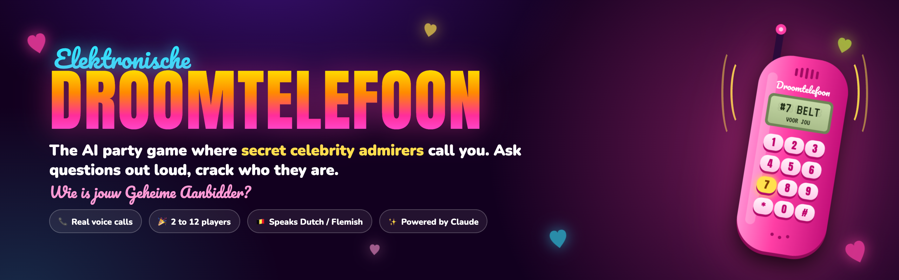
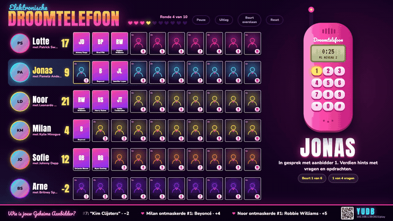
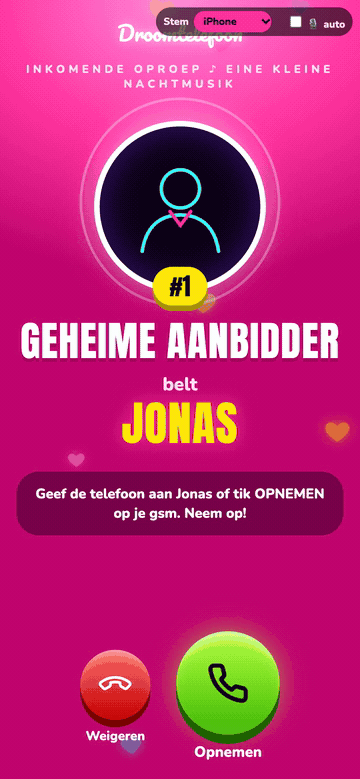
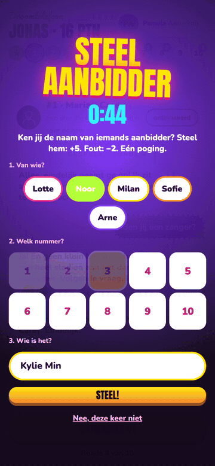
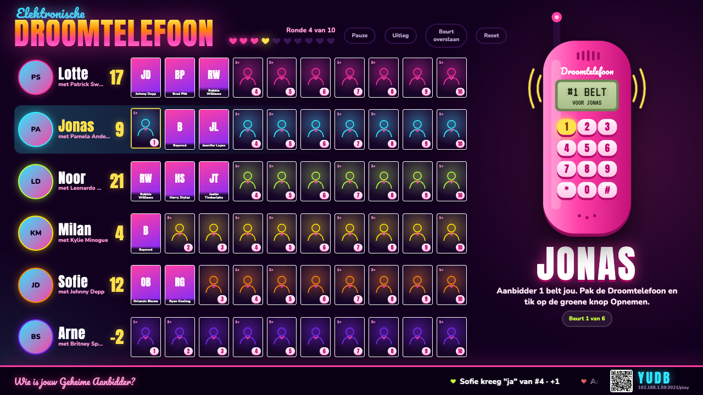
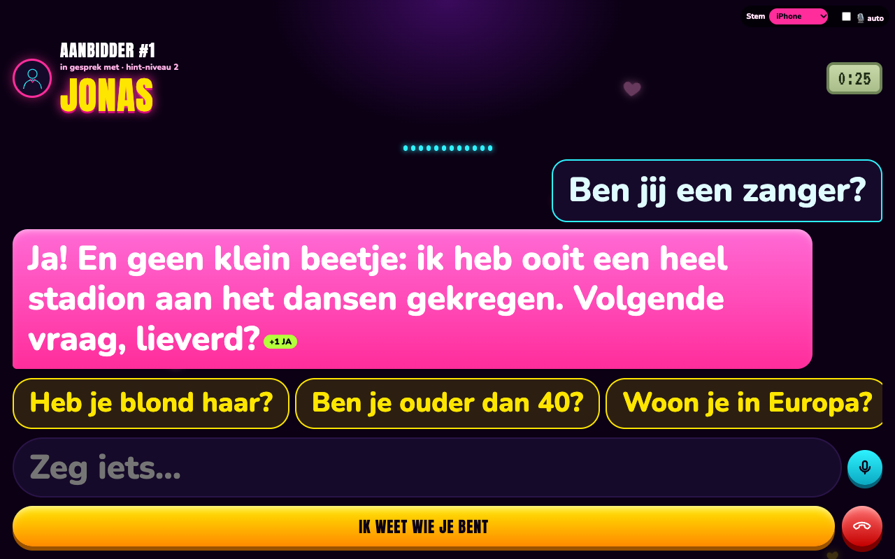
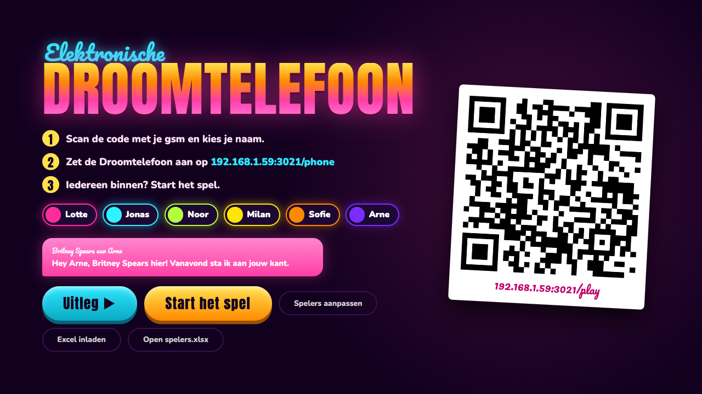
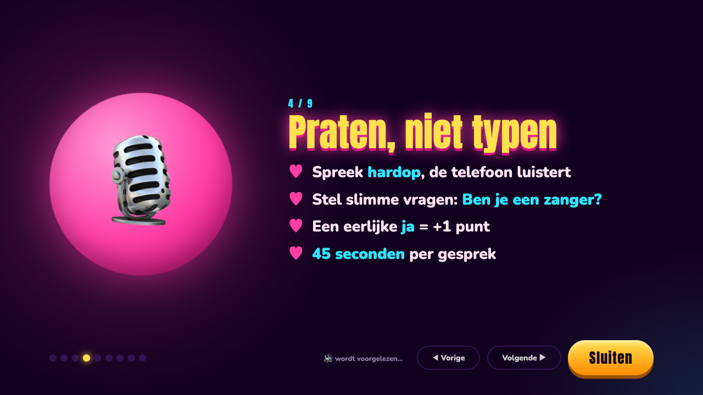
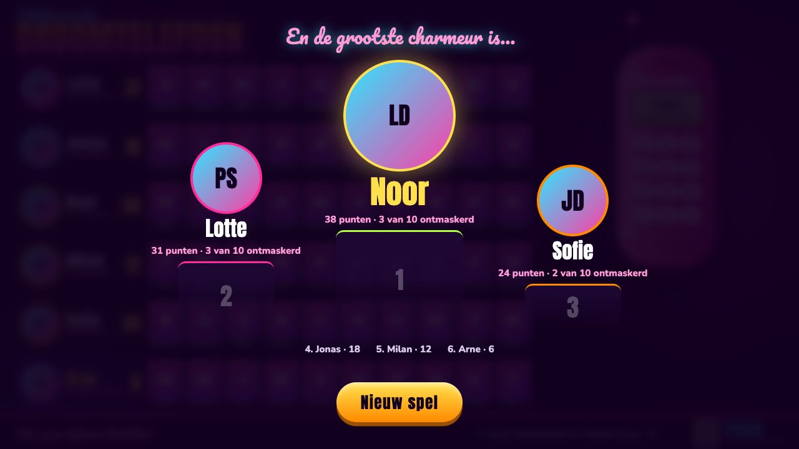
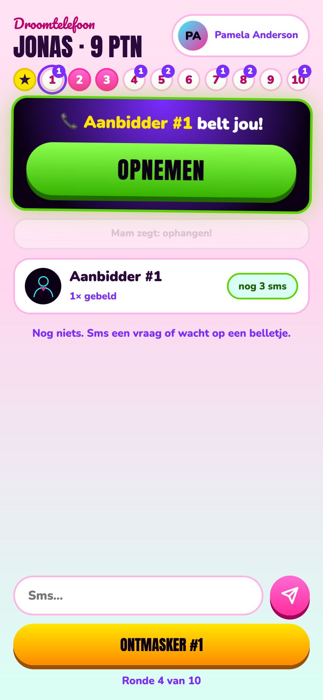

<p align="center">
  
</p>

<p align="center">
  <b>Your phone rings. A secret admirer is on the line. It's a celebrity… but which one?</b><br>
  A party game for one laptop, one big screen and 2 to 12 friends. The admirers are played live by Claude, and they talk back.
</p>

<p align="center">
  
  
  
  
  
</p>

<p align="center">
  
</p>

## How it plays

1. **Everyone gets 10 secret admirers.** Scan the QR code on the TV and pick your name. Behind each of your ten numbers hides a famous star who was big when *you* were a teenager.
2. **The Droomtelefoon rings.** Pick up and just talk, out loud. Ask smart yes/no questions: *"Are you a singer?"* The admirer flirts, teases and answers honestly, but never says their name.
3. **Crack it.** Hit **IK WEET WIE JE BENT** ("I know who you are") and type the name. Typos are fine. Right on the first call: 10 points. Wrong: minus 2, and they hang up on you.

Your first childhood crush is your teammate and calls with real tips. Every 10 minutes all phones flash **STEEL AANBIDDER**: if you overheard enough of someone else's call, steal their admirer. Most points wins.

<table>
  <tr>
    <td align="center" width="50%"><br><sub>The Droomtelefoon rings: a new ringtone every call</sub></td>
    <td align="center" width="50%"><br><sub>Every 10 minutes: steal someone's admirer</sub></td>
  </tr>
</table>

## Play in 2 minutes

You need a laptop (Mac or Windows), everyone's phone on the same Wi-Fi, a [Claude API key](https://platform.claude.com/settings/keys), and ideally a TV or beamer.

1. **Download** this repo: green **Code** button › **Download ZIP**, then unzip it.
2. **Double-click** `Start Droomtelefoon.command` (Mac) or `Start Droomtelefoon.bat` (Windows).
   - Mac, first time only: right-click the file › **Open** › **Open**. macOS asks this for anything downloaded from the internet.
   - Windows: "Windows protected your PC" › **More info** › **Run anyway**.
3. **Paste your Claude API key** when asked. It's saved next to the game, readable only by you. Press Enter without a key for a demo without AI.
4. **Two browser tabs open.** Drag the **board** to the TV and make it full screen. The **Droomtelefoon** stays on the laptop: its microphone and speaker are the phone everyone talks to. Press **Uitleg ▶** for a narrated tutorial, then **Start het spel**.

No installing, no terminal. The first time, the launcher puts Node.js inside the game folder if your computer doesn't have it (about 50 MB). On a Mac the laptop and screen stay awake while you play. Close the window to stop.

> **Tip:** Claude is pay-per-use. Set a monthly spend limit in the [Claude Console](https://platform.claude.com/settings/billing) under Spend limits, so a long night never surprises you.

## Screenshots

<table>
  <tr>
    <td width="50%"><br><sub><b>The board.</b> Ten cards per player flip as admirers get unmasked.</sub></td>
    <td width="50%"><br><sub><b>The call.</b> You talk, the admirer answers out loud. A smart question earns +1.</sub></td>
  </tr>
  <tr>
    <td><br><sub><b>The lobby.</b> Scan, pick your name, your teammate says hi.</sub></td>
    <td><br><sub><b>The tutorial.</b> Nine slides, read aloud, so nobody has to explain the rules.</sub></td>
  </tr>
  <tr>
    <td><br><sub><b>The finale.</b> Every missed admirer is revealed, then the podium.</sub></td>
    <td align="center"><br><sub><b>Your phone.</b> Pick up, dial, text your admirers, play your card.</sub></td>
  </tr>
</table>

## What makes it fun

- **Live AI admirers.** Every star has a personality, a voice and five hints that get stronger as the night goes on. They remember earlier calls and texts, and they never say their own name.
- **Voice to voice.** The Droomtelefoon listens hands-free and talks back. Questions come out loud, so the whole room hears every clue.
- **Era-perfect stars.** Tell the setup wizard your age, who you fall for and three crushes; Claude picks ten admirers from the years you were 12 to 25.
- **Forgiving guesses.** Phonetic matching plus a Claude jury, so *"Djustin Timberlek"* counts.
- **Your phone is your notebook.** Three texts per round to any admirer, the green OPNEMEN button, a dial pad, and one *Mam zegt: ophangen!* card to cut someone's call.
- **Party details.** Twenty retro ringtones, love GIFs while you wait, a pause button, breathers between calls, and a podium at the end.

## Language

The game speaks **Dutch (Flemish)**: the screens, the admirers and the tutorial. English and other languages are the next big step. Want it in your language? Open an issue or a pull request.

## Privacy and costs

- First names, ages, who players fall for and their crushes are sent to Anthropic's API to pick admirers and write the dialogue. Nothing else leaves the laptop.
- Game data stays on the laptop in `players.json`, `admirers.json` and `spelers.xlsx`, which are never committed.
- Conversations run on Claude Opus by default. Use `TALK_MODEL` to try another model.

## For tinkerers

```bash
npm install
npm start            # same as the launchers, without the hand-holding
```

| Variable | What it does |
|---|---|
| `PORT` | Port of the game (default 3000) |
| `ROUNDS` | Number of rounds (default 10) |
| `TALK_MODEL` | Claude model for the conversations |
| `STEAL_MINUTES` | Minutes between steal moments (default 10) |
| `DATA_DIR` | Where the game keeps its data |

- **An iPhone as the Droomtelefoon** (HTTPS with mkcert), photos of the teammates and drawn neon portraits of the admirers: see the Dutch host manual in [docs/HANDLEIDING.md](docs/HANDLEIDING.md).
- **Local Flemish voices** on Apple Silicon (Piper, Qwen3-TTS, OmniVoice): `voices/download.sh` and `voice_server.py`.
- **How it works**, from clue levels to scoring: [docs/design.md](docs/design.md).
- **Tests:** `npm test` runs a full game without an API key, in a temporary folder.

The Windows launcher is new; if it trips on your PC, please open an issue.

## Credits

- Inspired by the 1991 board game *Dream Phone*. This is a fan-made homage, not affiliated with or endorsed by Hasbro or Milton Bradley.
- Admirers and teammates: [Claude](https://www.anthropic.com/claude) by Anthropic. Love GIFs: Powered by [GIPHY](https://giphy.com). Teammate photos come from Wikimedia Commons under their own licenses and are credited locally. Fonts: Anton, Pacifico, Nunito and VT323 from Google Fonts.
- Made by [Tim Dries](https://github.com/tdries).

## License

[MIT](LICENSE)
